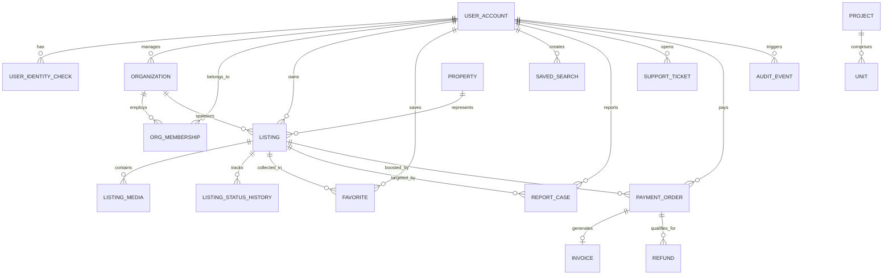

# مخطط العلاقات الكيانية (ENTITY RELATIONSHIP DIAGRAM - ERD)
**منصة عقار — الإصدار الرابع**

### القواعد الإلزامية للعلاقات:
1. **علاقة العقار بالإعلان (Property to Listing 1:N):** العقار المادي مفصول عن الإعلان التسويقي. قد يُعرض العقار للإيجار سنة، ثم يُعرض للبيع لاحقاً عبر إعلان منفصل مع الحفاظ على صك العقار.
2. **علاقة المشاريع بالوحدات (Project to Unit 1:N):** الوحدات العقارية التابعة للمشروع لها سجلات مستقلة وأسعار وتفاصيل معمارية، دون خلطها بالإعلانات الفردية.
3. **علاقة المنشأة بالأعضاء (Organization to Membership 1:N):** العضو لا يرتبط إدارياً بالمنشأة إلا بعد دعوة رسمية وقبول صريح وتحديد نطاق التفويض.
4. **حماية السجلات المالية:** جداول `PAYMENT_ORDER` و `INVOICE` و `AUDIT_EVENT` محمية تماماً من الحذف المتتالي (NO CASCADE DELETE) عند حذف أي حساب أو إعلان.
